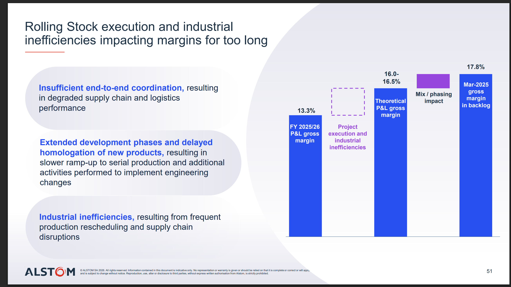

# Building trains more efficiently with AI at Alstom

**Alstom loses about 3 points of gross margin to project execution and industrial inefficiencies: 13.3% booked in FY 2025/26, against 16.0–16.5% without them.**



*Source: Alstom investor presentation, slide 51.*

The slide names three causes: poor end-to-end coordination across supply chain and logistics, late engineering changes that slow the ramp-up to serial production, and frequent production rescheduling.

This repo explores how AI can help recover that margin.

## The demo

Three noisy files describe a family of six train variants, `V1` to `V6`: an engineering BOM, a purchasing item list and free-text technical notes. The demo reconciles them and answers which sub-assemblies are reused, reusable, blocked or specific.

It works in two steps:

1. **Rules** settle what can be settled mechanically, such as two spellings of one part reference.
2. **An agent** settles the rest one item at a time, reading the notes, and asks a person when the data does not decide.

Every decision is recorded as a claim in `data/claims.jsonl`: what is stated, who stated it (a rule, the agent or a person) and on what evidence. The raw files in `data/raw/` are never changed. The reconciled database `out/pilot.db` is computed from the raw files and the claims, and can be deleted and rebuilt at any time.

### Run it

```
git clone git@github.com:opitcho/cognyx-case.git
cd cognyx-case
uv sync
uv run python -m pipeline.rules     # the rules append their claims to data/claims.jsonl
uv run python -m pipeline.build     # compute out/pilot.db from the raw files and the claims
```

These need no API key. The agent needs an OpenRouter key: copy `.env.example` to `.env` and fill in `OPENROUTER_API_KEY`.

```
uv run --env-file .env streamlit run jean-code/src/app.py        # the app
uv run --env-file .env python -m reconcile.chat                  # the same agent in the terminal
uv run --env-file .env python -m reconcile.batch --max-cost 2    # the agent settles the open items, up to 2 USD
```

The app has four pages: Agent (the chat), Raw data (the three files), Reconciled data (the database the agent queries) and Claims (the claim log).

### Go back to the demo's starting point

The demo starts from the rules' claims and the agent's, with no person's claim (`data/claims.demo_start.jsonl`). This puts the log back to that point and rebuilds the database. The log as it was is copied to `out/` first.

```
uv run python -m pipeline.reset
```

### See what each step did

```
uv run python -m pipeline.rules --list            # each rule, its description and the claims it makes
uv run python -m pipeline.build --made-by rule    # rebuild with the rules alone, without the agent
uv run python -m pipeline.build --without-notes   # rebuild without any claim that rests on a note
```

### Folders

| Folder | What it holds |
|---|---|
| `data/` | `raw/` the noisy files, `clean/` the same files before noise, `truth/` the answer key, `claims.jsonl` the claim log |
| `pipeline/` | The claim log, the rules (`rules.py`, one function per rule) and the build of the database. No model |
| `reconcile/` | The agent and its tools |
| `skills/` | The instructions the agent is given |
| `synth/` | The generator of the train family |
| `jean-code/` | The agent framework and the Streamlit app. Its own tests: `uv run pytest jean-code/tests` |
| `tests/` | `uv run pytest` |
| `docs/` | Notes on the data and the background research |

## Example questions

Questions the agent should be able to answer. Each takes several steps: a comparison across variants, a walk from a component up to the variants that use it, or a cost roll-up.

The answers below are computed from `data/clean/`, the files before noise is added, so they are what the agent should find once `data/raw/` is fully reconciled. Two things differ in practice:

- **Costs need a person first.** The noisy files give some parts two prices and others none. The agent says which parts block a total and asks which price holds.
- **References merged by a note count as one.** Once a note says `ST-4100` and `MP-4418` are one part (likewise `HC-6001` and `CL-0931`), the first question reports 38 under the same reference and 2 under another.

| Question | Answer |
|---|---|
| Which sub-assemblies of `V1` can I reuse in `V2`? | All 40 have the same content in `V2`. 36 keep the same reference. 4 are under another one: `HC-6001` as `CL-0931`, `KP-0457` as `DC-3001`, `RG-0212` as `TC-8100`, `ST-4100` as `MP-4418`. 4 contain an obsolete or superseded part: `DR-1043`, `FC-6100`, `HT-5300`, `KP-0457`. |
| `V3` and `V4` differ only by speed class (160 against 200 km/h). What differs, and is each difference justified? | 26 sub-assemblies are the same. `LR-1500` has the same content as `PB-2281`. 4 are nearly the same: the air duct (`VL-905` added) and the left door leaf (`JT-305` added) are both required for 200 km/h by a note, while the glazed partition (`BK-367` added) and the sliding step (12 bolts against 16) have no note. The other 9 are different designs. |
| `TH-415` is superseded. What is affected, and is the replacement already in use? | It is in `HT-5300` on all six variants. Its replacement `TH-450` is already used in `TC-8437` on `V4` and `V6`. The unit cost goes from 59.43 to 78.88 EUR. |
| What does the door system cost in each variant? | `V1` 229,555.56 EUR, `V2` 267,814.82, `V3` 331,683.36, `V4` 356,572.22, `V5` 439,188.24, `V6` 515,070.20. Every line has a price. |
| What would `V5` save by using seat frame `SF-9020` in place of `SF-9064`? | 11.48 EUR per unit, at 200 per train: 2,296.00 EUR per train. |
